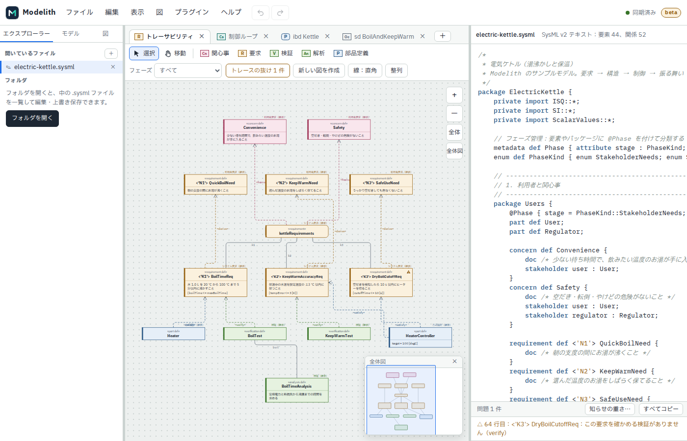

<a href="https://github.com/modelith">English</a> &nbsp;|&nbsp; <b>日本語</b>

  

  <b>テキストと図を同期して編集できる、オープンソースの SysML v2 モデリングエディタ</b> 
  SysML v2 / KerML modeling editor with synchronized text and diagram editing

  <a href="https://modelith.github.io/modelith/"><b>ブラウザで試す</b></a> &nbsp;|&nbsp;
  <a href="https://modelith.github.io/">マニュアル</a> &nbsp;|&nbsp;
  <a href="https://github.com/sponsors/modelith">支援する</a>
   
  <a href="https://github.com/modelith/modelith">ソースコード</a> &nbsp;|&nbsp;
  <a href="https://github.com/modelith/modelith/issues/new/choose">フィードバック</a>

  
  

 

## Modelith とは

システムエンジニア・学生・研究者のための、SysML v2 のモデリングエディタです。テキストで書いたモデルがすぐ図になり、図で動かした内容はテキストに書き戻されます。

  <a href="https://modelith.github.io/modelith/">
    <picture>
      <source media="(prefers-color-scheme: dark)" srcset="https://raw.githubusercontent.com/modelith/.github/main/profile/screenshot-dark.png">
      
    </picture>
  </a>

- **書いても、描いても、同じモデル** 
  テキストを打てば図に反映し、図で要素や関係を足せばテキストが書き換わります。

- **目的に合わせた図** 
  ブロック定義図・内部ブロック図・アクティビティ図・状態遷移図・シーケンス図・トレーサビリティなど、同じモデルを見たい切り口で表示できます。SVG や draw.io 形式でエクスポートすることもできます。

- **要求の抜けに気づける** 
  利用者要求から方式設計・検証までのつながりをたどり、導出・充足・検証の抜けを示します。

- **SysML v2 を知らなくても読める** 
  テキストのキーワードや図の名前にマウスを乗せると、その意味を表示します。

- **ブラウザを開くだけ** 
  インストールもアカウントも不要です。手元のフォルダを VS Code のように開いて、編集・保存できます。

- **モデルは手元から出ない** 
  モデルを外部に送信せず、アクセス解析も使いません。モデルはただのテキストファイルなので、Git で差分を追えます。

## リポジトリ

| リポジトリ | 内容 | ライセンス |
| --- | --- | --- |
| [modelith](https://github.com/modelith/modelith) | エディタ本体（Rust コア・Web アプリ・CLI） | AGPL-3.0 + [Plugin Exception](https://github.com/modelith/modelith/blob/main/PLUGIN-EXCEPTION.md) |
| [plugin-sdk](https://github.com/modelith/plugin-sdk) | プラグイン向けのインタフェース・型定義 | MIT |
| [modelith.github.io](https://github.com/modelith/modelith.github.io) | ユーザーマニュアル | MIT |

## 開発状況

**0.1.0** が最初の正式版です。**0.2.0** は正式版の候補（rc）を出しています。この先は、Claude などの AI が MCP を通じてモデルを読み・確かめ・編集できるようにし、自分で用意したサーバにプロジェクトを置けるようにしていく予定です。詳しくは [ロードマップ](https://github.com/modelith/modelith/blob/dev/README.ja.md#ロードマップ) をご覧ください。

## 参加する

- 使ってみた感想・「こんな図がほしい」は [Issues](https://github.com/modelith/modelith/issues/new/choose) へ。
- コードで貢献したい方は、[modelith リポジトリ](https://github.com/modelith/modelith)をご覧ください。
- 開発を支援してくださる方は、[GitHub Sponsors](https://github.com/sponsors/modelith) からお願いします。

 

SysML® and OMG® are registered trademarks, and KerML™ is a trademark, of Object Management Group, Inc. Modelith is an independent project and is not affiliated with or endorsed by OMG.
