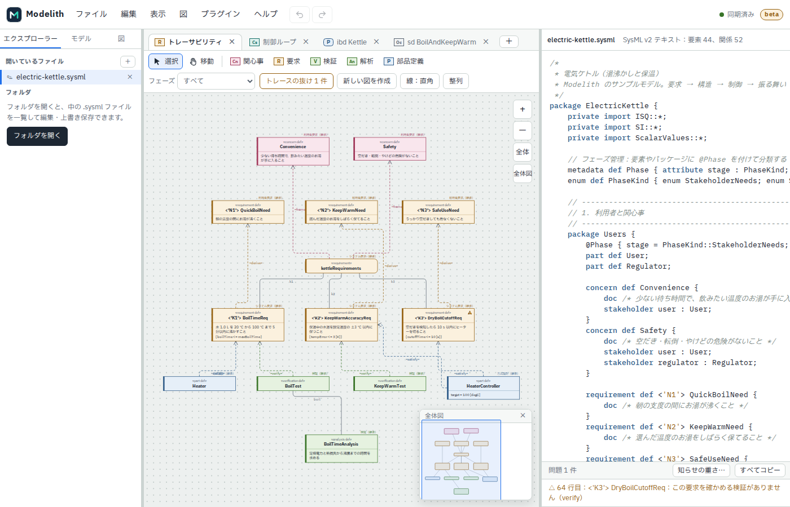

<b>English</b> &nbsp;|&nbsp; <a href="https://github.com/modelith/.github/blob/main/profile/README.ja.md">日本語</a>

  

  <b>An open-source SysML v2 modeling editor with synchronized text and diagram editing</b> 
  テキストと図を同期して編集できる、オープンソースの SysML v2 モデリングエディタ

  <a href="https://modelith.github.io/modelith/"><b>Try it in your browser</b></a> &nbsp;|&nbsp;
  <a href="https://github.com/sponsors/modelith">Sponsor</a>
   
  <a href="https://modelith.github.io/">Manual (ja)</a> &nbsp;|&nbsp;
  <a href="https://github.com/modelith/modelith">Source</a> &nbsp;|&nbsp;
  <a href="https://github.com/modelith/modelith/issues/new/choose">Feedback</a>

  
  

 

## What is Modelith?

A SysML v2 modeling editor for systems engineers, students and researchers. A model you write as text becomes a diagram right away, and what you change in the diagram is written back to the text.

  <a href="https://modelith.github.io/modelith/">
    <picture>
      <source media="(prefers-color-scheme: dark)" srcset="https://raw.githubusercontent.com/modelith/.github/main/profile/screenshot-dark.png">
      
    </picture>
  </a>

- **Write it or draw it — it's the same model.** 
  Type text and the diagram follows; add elements and relationships in the diagram and the text is rewritten.

- **Diagrams for each purpose.** 
  Show the same model from the angle you need: block definition, internal block, activity, state machine, sequence, traceability and more. Export them as SVG or draw.io.

- **Spot gaps in your requirements.** 
  Follow the chain from stakeholder needs through architecture to verification, and see where derivation, satisfaction or verification is missing.

- **Readable without knowing SysML v2.** 
  Hover over a keyword in the text or the name of a diagram to see what it means.

- **Just open a browser.** 
  No installation and no account. Open a local folder like in VS Code, then edit and save.

- **Your model stays with you.** 
  Modelith does not send your model anywhere and uses no analytics. A model is plain text, so you can track changes with Git.

## Repositories

| Repository | What it is | License |
| --- | --- | --- |
| [modelith](https://github.com/modelith/modelith) | The editor (Rust core, web app and CLI) | AGPL-3.0 + [Plugin Exception](https://github.com/modelith/modelith/blob/main/PLUGIN-EXCEPTION.md) |
| [plugin-sdk](https://github.com/modelith/plugin-sdk) | Interfaces and types for plugins | MIT |
| [modelith.github.io](https://github.com/modelith/modelith.github.io) | User manual (Japanese) | MIT |

## Status

**0.1.0** is the first stable version. **0.2.0** is in release candidates. Next, AI tools such as Claude will be able to read, check and edit your models through MCP, and you will be able to keep projects on a server you run yourself. See the [roadmap](https://github.com/modelith/modelith#roadmap) for details.

## Get involved

- Share what you think, or which diagrams you need, in [Issues](https://github.com/modelith/modelith/issues/new/choose). Issues in English or Japanese are welcome.
- To contribute code, see the [modelith repository](https://github.com/modelith/modelith).
- To support development, please sponsor us on [GitHub Sponsors](https://github.com/sponsors/modelith).

 

SysML® and OMG® are registered trademarks, and KerML™ is a trademark, of Object Management Group, Inc. Modelith is an independent project and is not affiliated with or endorsed by OMG.
