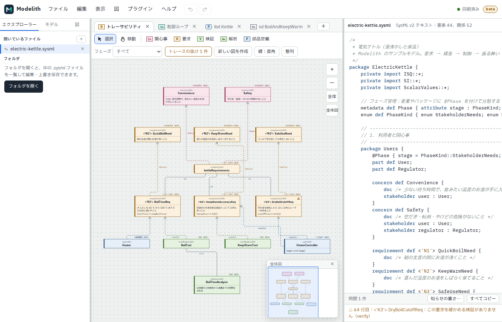

  

  <b>An open source SysML v2 modeling editor with synchronized text and diagram editing</b> 
  テキストと図を同期して編集できる、オープンソースの SysML v2 モデリングエディタ

  <a href="https://modelith.github.io/modelith/"><b>Try it in your browser</b></a> &nbsp;|&nbsp;
  <a href="https://github.com/sponsors/modelith">Sponsor</a>
   
  <a href="https://github.com/modelith/.github/blob/main/profile/README.ja.md">日本語</a> &nbsp;|&nbsp;
  <a href="https://modelith.github.io/">Manual (ja)</a> &nbsp;|&nbsp;
  <a href="https://github.com/modelith/modelith">Source</a> &nbsp;|&nbsp;
  <a href="https://github.com/modelith/modelith/issues/new/choose">Feedback</a>

  
  

 

## What is Modelith?

Modelith is a SysML v2 modeling editor for systems engineers, students and researchers. Write a model as text and it becomes a diagram right away; change the diagram and the text is rewritten to match.

  <a href="https://modelith.github.io/modelith/">
    <picture>
      <source media="(prefers-color-scheme: dark)" srcset="https://raw.githubusercontent.com/modelith/.github/main/profile/screenshot-dark.png">
      
    </picture>
  </a>

- **One model, whether you write or draw** 
  Typing in the text updates the diagram, and adding elements or relationships in the diagram rewrites the text.

- **The right diagram for the job** 
  View the same model as a block definition, internal block, activity, state transition, sequence or traceability diagram. Export diagrams as SVG or for draw.io.

- **Spot gaps in your requirements** 
  Follow the links from stakeholder needs through design to verification, and see where derivation, satisfaction or verification is missing.

- **Readable without knowing SysML v2** 
  Hover over a keyword in the text or a diagram name to see what it means.

- **Just open your browser** 
  No install and no account. Open a local folder, much like in VS Code, and edit and save your files.

- **Your model stays on your machine** 
  Modelith never sends your model anywhere and uses no analytics. Models are plain text files, so you can diff them in Git.

## Repositories

| Repository | What it is | License |
| --- | --- | --- |
| [modelith](https://github.com/modelith/modelith) | The editor (Rust core, web app and CLI) | AGPL-3.0 + [Plugin Exception](https://github.com/modelith/modelith/blob/main/PLUGIN-EXCEPTION.md) |
| [plugin-sdk](https://github.com/modelith/plugin-sdk) | Interfaces and types for plugins | MIT |
| [modelith.github.io](https://github.com/modelith/modelith.github.io) | User manual (Japanese) | MIT |

## Status

Modelith is in **beta for 0.1.0**. Features are frozen, and only bug fixes go in until 0.1.0. We shape it around feedback from test users, so please tell us about anything that behaves unexpectedly. After 0.1.0, we plan to grow it into a CLI, MCP, LSP, plugins and a server.

## Get involved

- Share what you think, or which diagrams you need, in [Issues](https://github.com/modelith/modelith/issues/new/choose).
- To contribute code, see the [modelith repository](https://github.com/modelith/modelith).
- To support development, please sponsor us on [GitHub Sponsors](https://github.com/sponsors/modelith).

 

SysML® and OMG® are registered trademarks, and KerML™ is a trademark, of Object Management Group, Inc. Modelith is an independent project and is not affiliated with or endorsed by OMG.
